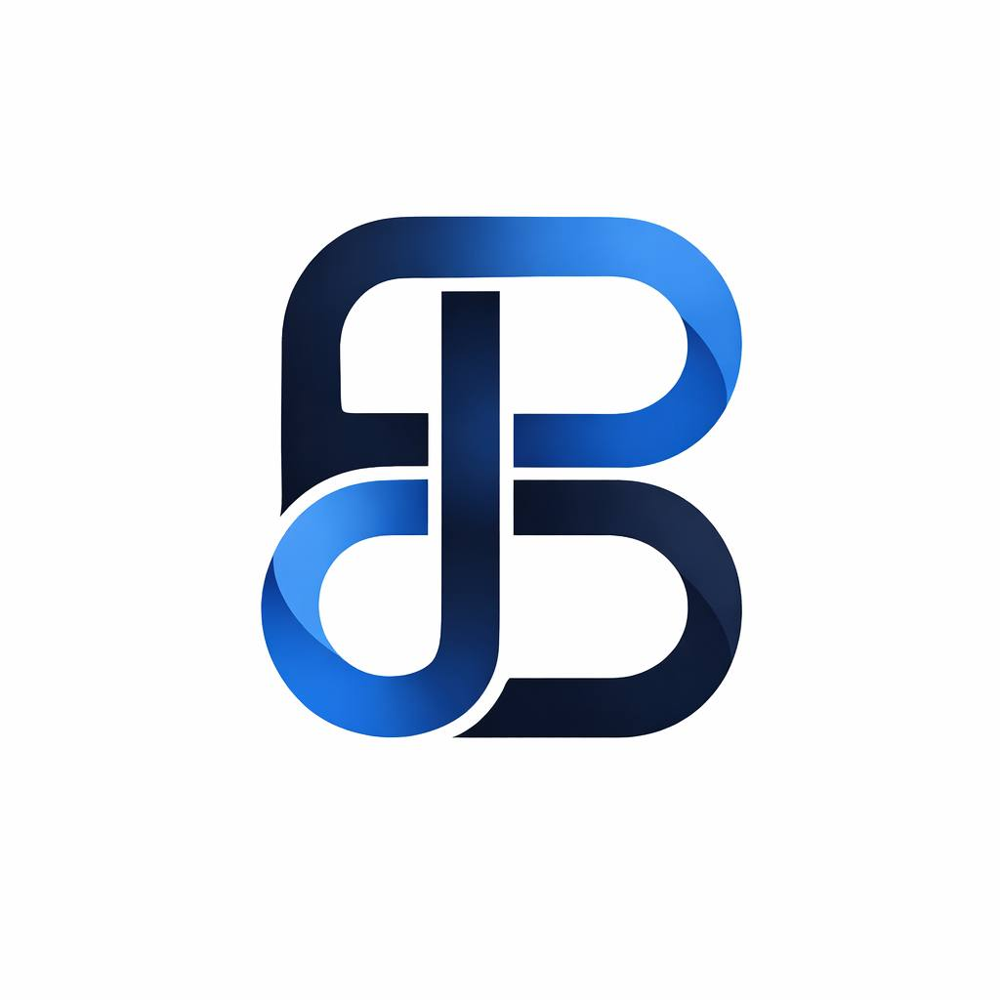
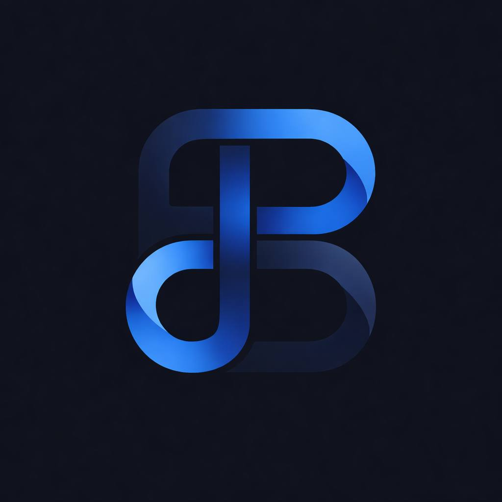

# BlueLink | Official Brand Assets

**Version:** 1.0.0 | **Issue date:** 20 October 2026 | **Status:** Final  
**Organization:** BlueLink Blockchain Services | **Document ID:** BL-001

The corporate logo library, visual identity standards and brand-use documentation for **BlueLink Blockchain Services**.

**Website:** [bluelinkos.com](https://bluelinkos.com/)  
**GitHub organization:** [bluelink-os](https://github.com/bluelink-os)  
**Brand and documentation inquiries:** [ai@bluelinkos.com](mailto:ai@bluelinkos.com)

## About BlueLink

BlueLink is a blockchain and digital-asset brand focused on tokenized real-world assets and digital markets. This repository provides a consistent source for its corporate artwork, public identity and brand documentation. Technical implementations and product-specific terms remain in their respective product repositories.

## Choose your asset

| Light-background presentation | Dark-background presentation |
|---|---|
|  |  |

Use the [original transparent PNG](logos/transparent/bluelink-monogram-transparent.png) when an application requires transparency. It has a 358 x 358 pixel canvas. The two original JPG presentations have 1024 x 1024 pixel canvases. Larger derived PNGs are convenience exports, not higher-detail originals.

## Documentation directory

| Task | Reference |
|---|---|
| Read the illustrated handbook | [Brand Identity & Governance Handbook](documents/BlueLink-Brand-Identity-and-Governance-v1.0.0.pdf) |
| Select and verify artwork | [Asset manifest](ASSET-MANIFEST.md) and [logo specifications](brand-guidelines/LOGO-SPECIFICATIONS.md) |
| Apply the visual system | [Brand guidelines](brand-guidelines/BRAND-GUIDELINES.md), [colors](brand-guidelines/COLOR-PALETTE.md), [typography](brand-guidelines/TYPOGRAPHY.md), [design tokens](brand-guidelines/DESIGN-TOKENS.json) |
| Understand rights and permissions | [Brand usage](BRAND-USAGE.md), [license](LICENSE.md), [IP notice](INTELLECTUAL-PROPERTY.md), [trademark policy](documents/TRADEMARK-POLICY.md) |
| Describe the company | [Company overview](documents/COMPANY-OVERVIEW.md) and [press boilerplate](media-kit/BOILERPLATE.md) |
| Identify products correctly | [Product branding](documents/PRODUCT-BRANDING.md), [BLT guidance](documents/BLT-BRAND-GUIDELINES.md), [ecosystem registry](documents/ECOSYSTEM-ASSET-REGISTRY.md) |
| Request permission | [Authorization process](documents/BRAND-AUTHORIZATION.md) and [request form](templates/BRAND-USE-REQUEST.md) |
| Maintain and publish the library | [Document control](governance/DOCUMENT-CONTROL.md), [asset approval](governance/ASSET-APPROVAL-POLICY.md), [release policy](governance/RELEASE-POLICY.md) |
| Check sources and official references | [Source register](governance/SOURCES.md) and [domain/link register](governance/DOMAIN-AND-LINK-REGISTER.md) |

## Release scope

Version 1.0.0 contains **three unique original corporate raster assets**, eight derived PNG exports, the visual specifications, rights and governance documents, an illustrated handbook, operational templates and checksum utilities. The duplicate transparent upload is recorded in provenance rather than distributed as a second logo variant.

Native SVG artwork, a standalone text wordmark, monochrome artwork and separately designated BLT or other product logos are **outside this release**. No raster file is relabeled as an original vector. Product naming guidance does not imply that a product-specific logo is included.

The color roles, typography and layout measurements in this edition form the **v1.0.0 documentation standard**. They do not purport to reconstruct historical website CSS or an unavailable original design specification.

## Repository layout

```text
logos/                Original corporate artwork and identified derivatives
brand-guidelines/     Visual rules, palette, typography, tokens and CSS
documents/            Company, product, trademark and IP documentation
governance/           Maintenance, evidence, approval and release procedures
media-kit/            Reusable company description
products/             Product identity references; no invented product artwork
templates/            Reusable request and decision forms
metadata/             Asset inventory, provenance, source and document records
tools/                Offline integrity verification
.github/              Pull-request checklist
```

## Rights and integrity

This is a **brand asset library, not an open-source trademark license**. Read [LICENSE.md](LICENSE.md) and [BRAND-USAGE.md](BRAND-USAGE.md) before reuse. Existing written permissions, applicable legal exceptions and GitHub platform rights are preserved.

Run from this directory with Python 3.9 or newer:

```bash
python tools/verify_assets.py
python tools/verify_repository.py
```

The first command verifies image bytes. The second verifies the packaged repository files. Neither contacts a network or modifies files. Checksums establish file consistency, not legal title or audit coverage.

## Versioning

This library has its own version history, separate from **BLT Smart Contracts v1.0.0**. Use [RELEASE-NOTES.md](RELEASE-NOTES.md) when publishing this brand release. The GitHub release itself records its publication time and tagged brand-repository commit; those are not replaced with a smart-contract commit or an invented publication record.

For the basis of company statements and external references, see [SOURCES.md](governance/SOURCES.md).
